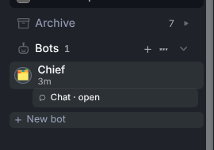

# MausBot for OpenCode Desktop

A roster of AI bots for OpenCode Desktop. Each bot is a normal OpenCode session
with its own personality, model, folder, approvals and long-term memory. The
bots live in a **Bots** fold in the left sidebar, directly under the app's
**Archive** fold and above the sidebar footer.

Inspired by [OpenMausBot](https://github.com/milind-soni/OpenMausBot): a team of
agents you talk to like contacts, running on the agents and tools you already
have.

MausBot is an independent project. It is not affiliated with, endorsed by, or
sponsored by OpenMausBot or its maintainer, and it does not include OpenMausBot
source code.

<p align="center">
  
</p>

## What you get

- **A Bots fold under Archive.** Rows show each bot's avatar, name, model and
  live state (working, new, or idle). Each bot's current chat sits directly
  beneath it as a child row. Pin, edit, duplicate, reset or delete a bot from
  its `…` menu.
- **The chat belongs to the bot.** The bot's current chat is hidden from the
  normal tab strip, the Home session list and session search. Open it from the
  bot's row or its **Chat** child row; close the tab from the bot's menu when you
  want it out of the way. Older chats started with **New chat** stay in Recent.
- **Bots are real OpenCode sessions.** They use your existing providers, tools,
  shell, browser and MCP servers. Nothing is proxied through another service.
- **Per-bot personality.** The profile is injected as a system instruction on
  every turn, so the bot stays in character across the whole conversation.
- **Per-bot model and folder.** Pick a model when you create the bot. Point it at
  a project or a dedicated bot folder.
- **Approvals.** The default **Ask first** preset asks before file edits and
  shell commands, using OpenCode's native approval cards. **Trusted** allows
  edits and asks before commands. **Autonomous** turns prompts off.
- **Long-term memory.** Each bot gets a `mausbot_remember` tool and a small
  on-disk memory file that is injected on later turns. Memory survives new
  chats.
- **Templates.** Start from Maus (assistant), Scout (researcher), Forge (coder),
  Quill (writer), Chief (chief of staff) or Muse (creative).
- **A full Bots panel.** The same roster is available from the side panel's `+`
  menu and from the command palette, so the feature still works if a future
  desktop update changes the sidebar DOM.

## Install

Requirements: OpenCode Desktop with GUI plugin support (developed and tested
against 2.3.2 on Linux; the plugin APIs it uses are cross-platform) and at least
one connected model provider.

### From a clone

```sh
git clone https://github.com/TheAliasAlias/opencode-mausbot.git
cd opencode-mausbot
sh install.sh
```

The script copies the plugin to
`~/.config/opencode/plugins/opencode-mausbot` and adds that path to the
**global** `~/.config/opencode/opencode.json`. The desktop app reads GUI plugins
from the global config.

### Manually

1. Copy this directory to `~/.config/opencode/plugins/opencode-mausbot`.
2. Add its absolute path to the `plugins` array in
   `~/.config/opencode/opencode.json`:

   ```jsonc
   {
     "plugins": ["/home/you/.config/opencode/plugins/opencode-mausbot"]
   }
   ```

3. Open **Settings → Extensions → Plugins** and make sure **MausBot** is
   enabled. No restart is needed; the app reloads plugins when the config
   changes.

### As an npm package

The package is publish-ready. After publishing:

```sh
opencode plugin add opencode-mausbot
```

or add `"opencode-mausbot"` to `plugins` in the global config.

## Create your first bot

1. Click **+** in the **Bots** fold (or run **MausBot: New bot** from the
   command palette).
2. Pick a template or write a personality.
3. Choose a model, a folder and an approval preset.
4. Click **Create bot**. The chat opens in a normal tab.

The bot's name is used as the session title. Its live state appears in the fold:
a green dot while it is working and a blue dot when there is something new.

## The `mausbot_remember` tool

Bots can save durable notes with:

```text
mausbot_remember(note: "The user prefers short, direct answers.")
```

Notes are stored per bot at:

```text
${XDG_DATA_HOME:-~/.local/share}/opencode-mausbot/bots/<bot id>/memory.md
```

The file is capped at 128 KB, and the latest 12 KB is injected into the model
context. Notes are never added to a normal, non-bot session. To start a bot
without old memories, delete its memory directory after deleting the bot.

## Use a different memory location

Pass an option in the global config:

```jsonc
{
  "plugins": [
    {
      "package": "/home/you/.config/opencode/plugins/opencode-mausbot",
      "options": {
        "memoryDirectory": "/home/you/synced/mausbot-memory"
      }
    }
  ]
}
```

## Commands

| Command | What it does |
| --- | --- |
| `MausBot: New bot` | Open the create dialog |
| `MausBot: Open bots panel` | Open the full roster in the side panel |
| `MausBot: Chat with a bot…` | Pick a bot and open its chat |
| `MausBot: Toggle bots fold` | Show or hide the sidebar fold |

Commands are in the command palette. The side panel's `+` menu also lists
**Bots**.

## How it is put together

The package has two parts, both loaded by the normal plugin system:

- `index.js` is the server part. It registers a `context` hook that appends the
  bot's persona and memory to model requests, a `title` hook that keeps the
  session named after the bot, and the `mausbot_remember` tool.
- `gui-experimental.cjs` is the window part. It stores the roster in the
  documented plugin store (`plugin.mausbot.settings`), creates sessions through
  the OpenCode client, and renders the fold, panel, menus and dialog with plain
  DOM and the app's CSS variables.

The bot profile lives in the session's own `metadata.mausbot` field. That means
a desktop update does not need to migrate a separate database, and the chats are
ordinary sessions you can inspect from the normal OpenCode UI. While the plugin
is active, `hideBotSessions()` marks the current chat's rows in the normal tab
strip, Home list and search results as hidden, so it appears only under its bot.
Disabling the plugin removes those markers and the chat returns to the normal
lists.

### Why updates should be gentle

- All data and behaviour use documented plugin APIs: `Plugin.define`, `Store`,
  `Command`, `MenuItem`, `Panel`, session hooks and tool transforms.
- There is no build step, no bundled copy of Solid, and no dependency on
  minified app modules.
- The only app-specific surface is the sidebar mount and the session-list
  filtering. The mount is isolated in `ensureFold()` and anchored to
  `[data-slot="sidebar-archive"]`. Bot tabs and Home rows are marked hidden in
  `hideBotSessions()` by session id. If a future release renames those elements,
  the fold falls back to the tabs list and the Bots panel; if the whole sidebar
  changes, the panel and command palette still work.
- The plugin never patches `app.asar` or any installed file.

If a desktop update does move the sidebar, please open an issue with the
version. The fix should be a one-line selector update.

## What this is not

OpenMausBot is a full messaging app with cloud computers, Composio app
connections, voice calls and group channels. This plugin recreates the part that
fits inside OpenCode Desktop: the roster of personalities, each with a real
agent session, its own model, folder, approvals and memory. Bots inherit the
tools and MCP servers you have configured in OpenCode; there is no separate
cloud VM or app marketplace.

## Security

Bots are real agents: they inherit the tools, shell, filesystem, browser and MCP
servers available to an OpenCode session. The approval preset is the safety
boundary, not a sandbox.

- **Ask first** is the default and asks before file edits, shell commands and
  access outside the session directory.
- **Autonomous** removes those prompts. Use it only in folders you trust.
- Bot instructions and memory are plain text, stored in session metadata and on
  disk, and sent to the model provider. Do not put passwords, tokens or other
  secrets in a bot's personality or memory.
- The plugin makes no network requests of its own and does not read or store
  provider credentials. Model calls and tools go through your OpenCode session.
- Hiding a bot's chat from the normal lists is cosmetic; it does not change
  permissions or hide data from the server.

See [SECURITY.md](SECURITY.md) for the reporting process and the full security
model. Please use GitHub's private vulnerability reporting for security issues.

## Credits

MausBot is inspired by
[OpenMausBot](https://github.com/milind-soni/OpenMausBot), an open-source
Grok Bot alternative, licensed under the Apache License 2.0. OpenMausBot is not
affiliated with this project, and no OpenMausBot code is included here. The bot
roster, OpenCode integration, memory tool and sidebar fold are original to this
project.

## Uninstall

```sh
sh uninstall.sh
```

or remove the plugin path from the global `opencode.json` and delete
`~/.config/opencode/plugins/opencode-mausbot`. Deleting the plugin does not
delete the bot sessions; delete them from the roster first if you want them
gone.

## Development

There is no bundler. Edit `gui-experimental.cjs` or `index.js` and reload the
plugin from **Settings → Extensions → Plugins**, or restart the app. The plugin
is also easy to test in a second OpenCode window with remote debugging:

```sh
opencode --remote-debugging-port=9222
```

(MausBot does not use the debugging port itself.)

## License

Apache License 2.0. See [LICENSE](LICENSE) and [NOTICE](NOTICE). The license is
the same one used by OpenMausBot.
